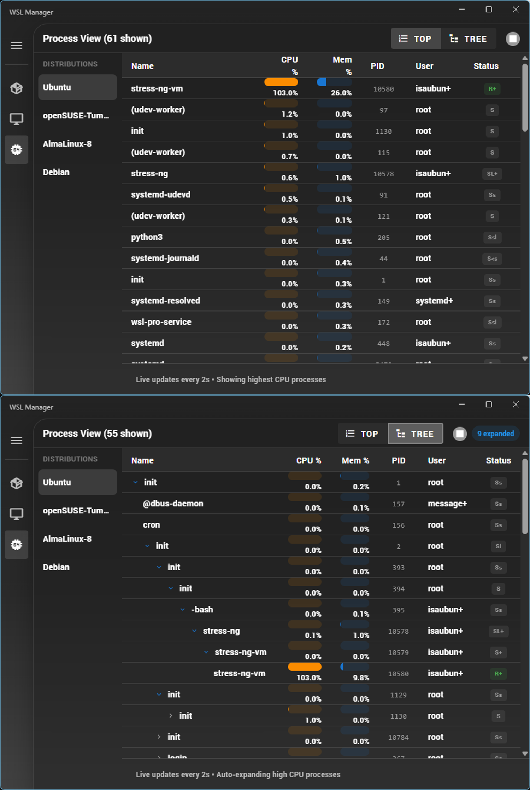
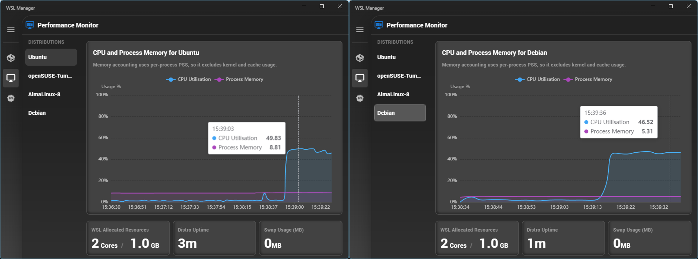
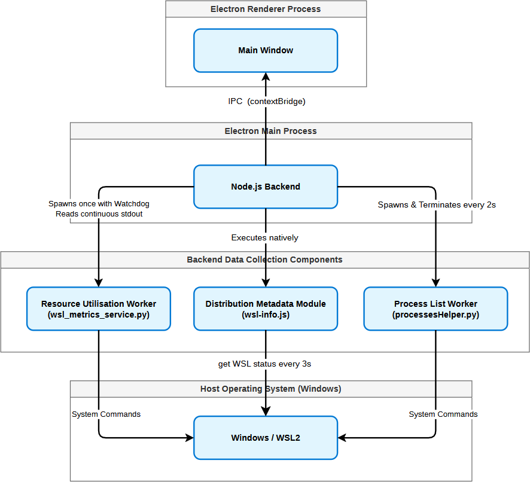

# WSL Manager

An Electron desktop application for monitoring and managing individual WSL distributions from Windows.

## Project status

This repository is a portfolio snapshot of an academic project, not a production-ready release. See Known limitations below.

## Features

- Per-distribution resource monitoring: View real-time CPU and memory usage for individual WSL distributions through live graphs.
- Distribution management: View installed distributions and their running states, start and stop distributions, change the default distribution, and delete distributions.
- Process monitoring: Inspect each distribution’s processes, including CPU usage, memory usage, process ID, user, and status.
- Process hierarchy: Switch between a highest-CPU process list and an expandable parent–child tree, with automatic expansion of high-CPU processes.
- Process termination: Terminate individual Linux processes directly from the graphical interface.
- Additional system information: View WSL resource allocation, distribution uptime, and swap usage.
- Familiar interface: Navigate between management, performance, and process views using a Windows Task Manager-inspired layout.

## Screenshots

The screenshots below show two instances of the same application opened
side by side for comparison. This setup demonstrates the
per-distribution monitoring and inspection views.

### Performance monitoring


### Process monitoring



### CPU validation



## Architecture

The application separates the desktop interface from system operations
and background data collection.



- Renderer process: Displays the Vue.js interface, including distribution management, resource graphs, and process views.
- Preload bridge: Exposes the application's IPC interface between the renderer and the Electron main process.
- Main process: Coordinates WSL operations, manages background workers, and passes monitoring data to the interface.
- Resource monitoring worker (`wsl_metrics_service.py`): Runs persistently and streams resource measurements through standard output, with a watchdog supervising the worker.
- Distribution metadata module (`wsl-info.js`): Queries distribution status and metadata through Windows-side WSL commands.
- Process monitoring worker (`processesHelper.py`): Runs periodically to retrieve process information for the process list and hierarchy views.

### Design decisions

Resource monitoring uses a persistent worker to avoid repeatedly starting
the Python interpreter for each measurement. Process information is
collected through a separate periodic worker.

System operations are handled outside the renderer, with communication
through the preload bridge. This separates interface logic from
privileged operations and background data collection.

Application source code is located in `src/`.

## Per-distribution telemetry

WSL2 distributions share a Linux kernel and a common CPU, memory, and
swap resource pool. Consequently, whole-system figures reported by
tools such as `free` and the summary section of `top` reflect the
shared WSL2 environment, rather than usage attributable to one
distribution.

However, each distribution has its own PID namespace. WSL Manager
uses this separation to estimate per-distribution resource usage
by aggregating data from the processes visible inside each distribution.

The monitoring worker runs on Windows and uses
`wsl.exe -d <distribution>` to execute data-collection commands
inside each running distribution.

### CPU utilisation

The worker reads `/proc/<pid>/stat` and sums each process's user-mode
and kernel-mode CPU time (`utime` and `stime`).

CPU utilisation is estimated from the change in this total between
successive samples, converting clock ticks into seconds using
`getconf CLK_TCK`. The result is normalised by the detected CPU core
count to express usage relative to the available WSL CPU capacity.


### Memory and swap

The worker reads `/proc/<pid>/smaps_rollup` as root and sums the
Proportional Set Size (`Pss`) of the visible processes. PSS divides
shared resident memory proportionally between the processes using it,
rather than counting the full shared allocation for each process.

It also sums the per-process `Swap` fields. Memory utilisation is
expressed relative to the WSL memory limit read from `.wslconfig`,
with a fallback of 50% of host RAM. This limit applies to the shared
WSL2 environment, not a separate allocation for each distribution.

These measurements are process-based estimates, rather than complete
accounting of all kernel and filesystem-cache resource usage.

## Requirements

* Windows 11 with WSL already installed
* At least one WSL distro
* Node.js and npm
* Python 3 on the Windows PATH

Node `v24.12.0` and npm `11.7.0` are confirmed working on the current machine.

## Installation and running

This app is a Windows Electron app that calls `wsl.exe` and Windows-side Python scripts.

Run these commands in Windows Command Prompt (`cmd.exe`), not inside
a Linux WSL shell.

Download or clone the repository, then open Command Prompt in the
project root—the folder containing `package.json` and `requirements.txt`.

Install the prerequisites listed above before continuing. If you have
just installed Node.js or Python, open a new Command Prompt so the
updated PATH is available.

### First-time setup

The commands below select Python 3.14 explicitly.

```bat
py -3.14 -m venv .venv
.venv\Scripts\activate.bat
python -m pip install --upgrade pip
python -m pip install -r requirements.txt
npm install
npm run dev
```

### Subsequent runs

Open Command Prompt in the project root and run:

```bat
.venv\Scripts\activate.bat
npm run dev
```

## Known limitations

- The packaged Windows build does not currently bundle the Python helper scripts under `src/py/`; running from source in development mode as described above is recommended.
- Distribution deletion does not currently display a confirmation dialog. Use this action with caution.
- Known dependency vulnerabilities remain.